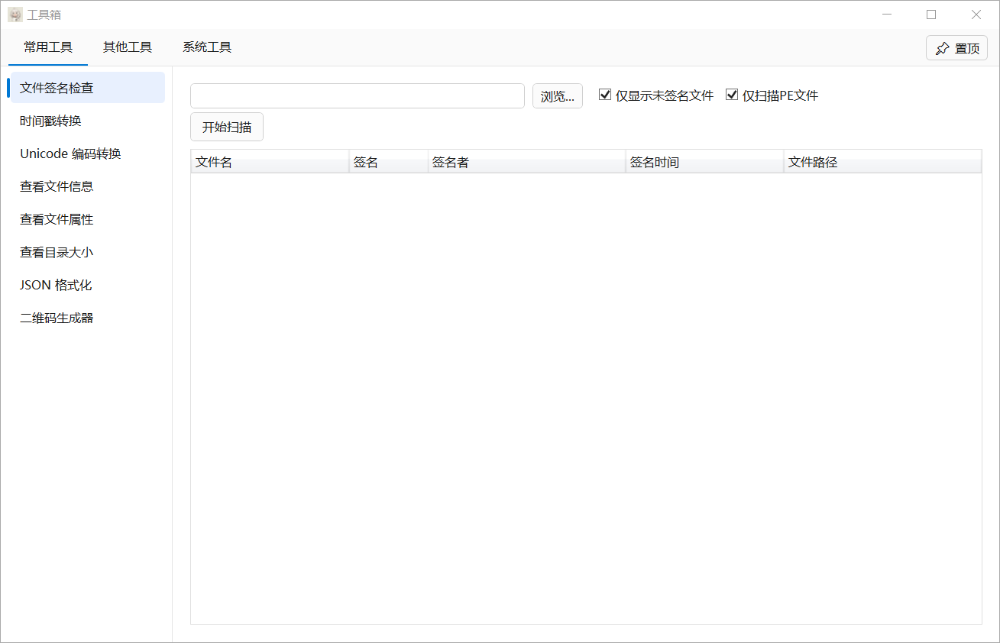
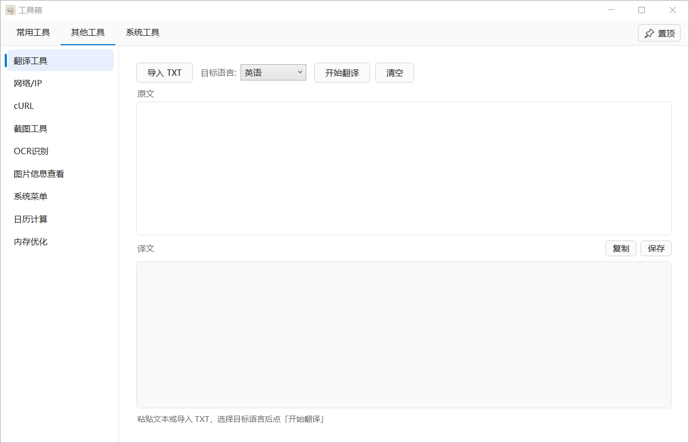
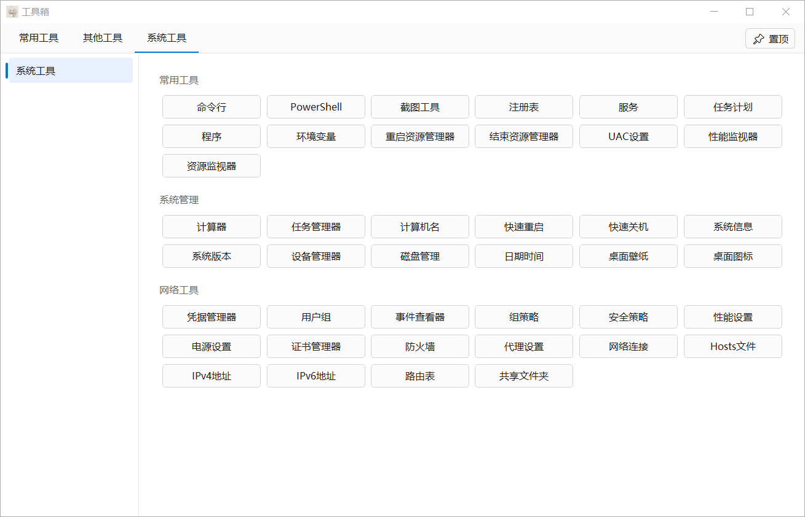

# Toolbox 工具箱

Windows 桌面端多功能工具集合，基于 WPF (.NET Framework 4.8)。

主程序为单窗口侧边栏导航的图形界面，集成 18 个常用工具；其中 13 个功能可通过 `Toolbox.exe cli <命令>` 调用，输出统一 JSON 格式，便于脚本化与自动化集成。

## 界面预览







## 功能一览

按分类划分（实际界面顺序见左侧导航栏）：

**常用工具**（8）
- 文件签名检查（按 magic number 识别真实类型）
- 时间戳 ↔ 日期互转
- Unicode 编码转换
- 文件信息（大小、MD5、修改时间、签名信息）
- 文件属性（隐藏/只读/系统）批量查看与修改
- 目录大小递归统计
- JSON 格式化 / 压缩 / 校验
- 二维码生成器（ZXing）

**其他工具**（9）
- 翻译工具（微软翻译，免密钥签名通道）
- 网络/IP（IPv4/IPv6 地址、DNS、ping、防火墙规则管理、网卡过滤）
- cURL 命令执行（支持 bash / cmd 格式，可保存二进制响应体）
- 截图工具（全屏 / 区域截图，直接写入剪贴板）
- OCR 识别（本地 PP-OCRv4，OnnxRuntime 推理，首次使用自动下载模型约 14 MB）
- 图片信息查看（从 EXIF / JPEG header 解码拍摄参数）
- 内存优化（收缩所有进程工作集 + 清指令缓存，循环多 pass 触发内核异步 pageout，回收 Standby / Modified List）
- 系统右键菜单管理（基于开源 SysMenuExtender 整合）
- 日历计算（公历/农历/藏历/回历、星座、节气、节日、黄历宜忌、小六壬吉凶）

**系统工具**（1）
- 一键启动常用 Windows 系统组件：命令行、PowerShell、注册表、服务、任务计划、设备管理器、网络连接、防火墙、组策略、Hosts 文件、各类控制面板项等

## 运行环境

- Windows 10 / 11
- .NET Framework 4.8 运行时（Win10 1903+ / Win11 内置）

## 构建

```bash
# 调试构建
dotnet build

# Release 构建
dotnet build -c Release

# 发布（多文件输出到 publish\MultiFile）
publish_dir.bat

# 发布（单文件输出到 publish\SingleFile，启用 Costura.Fody 合并 + gzip 内嵌 onnxruntime）
publish_single.bat
```

输出程序集名为 `Toolbox.exe`。单文件模式约 6 MB，运行时把 `onnxruntime.dll` 释放到 `%APPDATA%\Toolbox\native\`。

## 项目结构

```
ToolboxApp/
├── App.xaml(.cs)               # 全局样式、Mutex 单实例、--minimized 启动参数
├── MainWindow.xaml(.cs)        # 侧边栏导航、页面工厂注册、托盘图标、开机自启
├── Program.cs                  # 入口（区分 GUI 与 cli 子命令）
├── Cli/CliHandler.cs           # CLI 子命令分发与实现
├── Utils/
│   ├── OcrModelManager.cs     # OCR 模型下载 / 解压 / 缓存（PyPI 官方源 + 清华镜像双源）
│   ├── PpOcrEngine.cs         # ONNX Runtime 推理封装
│   ├── CurlParser.cs / CurlExecutor.cs   # cURL 命令解析与执行
│   ├── TranslateService.cs    # 微软翻译免密钥通道
│   └── Snapshot.cs / WpfRegionSelectWindow.xaml(.cs)   # 截图与区域选择
├── Views/
│   ├── Common/                # 常用工具页面
│   ├── Other/                 # 其他工具页面
│   ├── SysTools/              # 系统工具页面
│   ├── SysMenu/               # 系统右键菜单子模块
│   └── PlaceholderPage.xaml   # 页面加载失败时的兜底视图
└── Resources/
    ├── icons/                 # 应用图标（内嵌为 WPF Resource，非文件拷贝）
    └── ocr_keys.txt           # OCR 字典
```

## 架构要点

- **单窗口 + 页面导航**：左侧分类标签（常用 / 其他 / 系统）+ 工具列表，右侧 `ContentControl` 显示当前选中的 `UserControl`。
- **懒加载 + 缓存**：所有页面以 `Func<UserControl>` 工厂委托注册，首次选中时实例化并缓存在 `_pages` 字典中，避免启动时全量构造造成的卡顿。
- **单实例运行**：通过命名 Mutex (`ToolboxApp_SingleInstance`) + 命名事件 (`ToolboxApp_ShowWindow`) 保证只运行一份，重复启动会唤起已运行的实例。
- **托盘 + 开机自启**：托盘图标右键菜单提供打开/开机自启切换/退出；开机自启通过写入 `HKCU\...\Run` 实现，附 `--minimized` 参数静默启动到托盘。托盘 icon 从程序集内嵌的 `g.resources` 里读，不依赖文件路径。
- **CLI 双模**：`Program.cs` 检测首个参数为 `cli` 时不创建 GUI，进入 `CliHandler.Run`，所有工具可纯命令行调用。
- **数据目录**：所有应用数据统一放 `%APPDATA%\Toolbox\`（SysMenu 设置 / OCR 模型 / 单文件模式下的原生库释放）。

## CLI 用法

```bash
Toolbox.exe cli help                          # 查看所有命令
Toolbox.exe cli timestamp --ts 1700000000     # 时间戳 → 本地时间
Toolbox.exe cli qrcode --text "https://..." --output qr.png
Toolbox.exe cli json-format --input input.json
Toolbox.exe cli ocr --path screenshot.png     # 本地 OCR
```

完整命令列表用 `Toolbox.exe cli help` 查询。

### 当前支持的 CLI 命令

`help` / `file-sign-check` / `timestamp` / `unicode` / `file-info` / `file-attr` / `dir-size` / `json-format` / `qrcode` / `translate` / `ocr` / `image-info` / `firewall` / `systool`

## 添加新工具页面

1. 在 `ToolboxApp/Views/<分类>/` 下创建 `MyToolPage.xaml` + `MyToolPage.xaml.cs`（标准 WPF `UserControl`）。
2. 打开 `MainWindow.xaml.cs`，在 `RegisterPages()` 的 `allTools` 列表中追加：
    ```csharp
    ("我的工具", () => new Views.Other.MyToolPage()),
    ```
3. 如需归入"常用"分类，把名称加进 `commonSet`；否则默认进入"其他"分类。
4. 页面会自动懒加载、缓存，无需其他改动。

## 技术栈

- .NET Framework 4.8 / WPF / C# (LangVersion: latest)
- 传统 code-behind 模式（无 MVVM 框架）
- NuGet 主要依赖：
  - Newtonsoft.Json — JSON 处理
  - ZXing.Net — 二维码生成
  - tyme4net — 日历计算（农历/藏历/回历/节气/黄历/小六壬）
  - Microsoft.ML.OnnxRuntime — 本地 PP-OCRv4 模型推理（OCR 识别）
  - Costura.Fody — 单文件发布时合并程序集（`onnxruntime.dll` 例外，走 gzip 内嵌）

## 约定

- UI 文本与代码注释使用中文
- 根命名空间 `ToolboxApp`，页面命名空间 `ToolboxApp.Views.*`
- WinForms 引用仅用于 `NotifyIcon`（系统托盘）、`RoundedContextMenuStrip`（圆角右键菜单）和 SysMenu 子模块
- OCR 模型缓存与 SysMenu 设置统一放 `%APPDATA%\Toolbox\`，不再分散到 LocalAppData

## 致谢 / 第三方依赖许可

本工具依赖以下第三方开源组件与模型：

- [PaddleOCR / PP-OCRv4 模型](https://github.com/PaddlePaddle/PaddleOCR) — OCR 识别所使用的手写体/印刷体中英文模型（`ch_PP-OCRv4_det_infer.onnx` / `ch_PP-OCRv4_rec_infer.onnx` / `ch_ppocr_mobile_v2.0_cls_infer.onnx`），通过 [rapidocr_onnxruntime](https://pypi.org/project/rapidocr_onnxruntime/) 发布，模型权重 **Apache 2.0** 授权。首次使用 OCR 功能时会自动从 PyPI 官方源或清华镜像下载 wheel 包并解压模型到本地缓存。
- [ONNX Runtime](https://github.com/microsoft/onnxruntime)（`Microsoft.ML.OnnxRuntime` NuGet 包）— 模型推理引擎，**MIT** 授权。
- [ZXing.Net](https://github.com/codefilos/Safe-QR-Code-reader) — 二维码生成，**Apache 2.0** 授权。
- [tyme4net](https://www.nuget.org/packages/tyme4net/) — 农历/节气/黄历计算，商业授权（详见 NuGet 页面）。
- [Costura.Fody](https://github.com/Fody/Costura) — 单文件发布合并，**MIT** 授权。
- [SysMenuExtender](https://github.com/andrewsabin/SysMenuExtender) — 系统右键菜单扩展功能（"系统右键菜单" 页面），**GPL-3.0** 授权。相关代码在 `ToolboxApp/Views/SysMenu/` 下。

## License

本项目代码以 [MIT License](https://opensource.org/licenses/MIT) 授权发布。第三方依赖按上表各自授权独立适用。